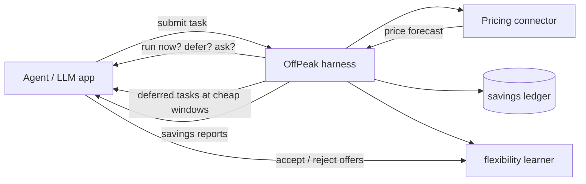

# OffPeak

**Temporal inference cost arbitrage for AI agents.**

Inference prices rise and fall with grid load — cheap overnight, expensive at evening peak. OffPeak is an open-source harness that lets any agent or LLM app defer non-urgent work to cheap hours, track every dollar saved, and learn how much scheduling flexibility each user actually has.

> Built for **AGI House Hackathon** · November 2026 · MIT licensed

## The problem

AI agents burn tokens at 6 PM — the most expensive hour on the grid. Electricity spot prices routinely swing **3–5x** between overnight troughs and evening peaks, and inference providers increasingly pass those costs through as time-varying $/Mtok pricing. Yet agents run *everything* immediately: deep research, batch summarization, report drafts — work that could just as easily run at 3 AM for 60–70% less.

## What OffPeak does

- **Temporal pricing connector** — reads a provider's time-varying inference price schedule. A realistic time-of-day "duck curve" placeholder is bundled; swap in a real connector (e.g. Crusoe) when your provider exposes one.
- **Price-aware scheduling** — for every task, the harness finds the cheapest window before the task's deadline and decides: run now, defer, or ask.
- **Savings ledger** — tracks actual spend, savings vs. running immediately, and savings vs. the daily peak. Honest numbers only.
- **Voices the savings** — agents tell users what was saved and what could be saved: *"I can run this at 3:00 AM for 73% less — the same budget buys ~3.5x deeper thinking."*
- **Learns your flexibility** — every accept/reject of a deferral offer updates a per-category model of your urgency preferences. Once you usually accept, OffPeak auto-defers.
- **Works with any agent** — MCP-native, plus a clean Python API. Zero required dependencies.

## How it works



## Quickstart

```bash
git clone https://github.com/tbarrios/offpeak-inference.git
cd offpeak-inference
pip install -e .

# Offline end-to-end demo (no LLM, no network, deterministic)
offpeak demo

# See today's price curve and the cheapest upcoming window
offpeak price

# Submit a task for price-aware scheduling
offpeak submit "Research the market for X" --category research --tokens 80000
```

Sample demo output:

```
≈ OffPeak demo — a day in the life of a cost-aware agent ≈

[06:00 PM] Submitting two deep-research tasks at evening peak…
⚡ OffPeak: I can schedule this research task for 03:00 AM at $0.25/Mtok
   — 71% cheaper than running now ($0.87/Mtok). That's ~$1.24 saved on
   2,000,000 tokens — the same budget buys ~3.5x deeper thinking at that hour.
   Want me to defer it?
> (user accepts)
🌙 Scheduled for 03:00 AM at $0.25/Mtok — 71% below the price right now…

[03:00 AM] Cheap window arrived — running deferred tasks…
✓ Ran at 03:00 AM for $0.25/Mtok — saved $1.24 vs running at submit time ($0.87/Mtok).

[08:00 AM] Morning report:
💰 OffPeak savings
   Tasks completed: 2 (2 deferred to cheap windows)
   ...

[06:00 PM] Next evening — submitting another research task…
🌙 Auto-scheduled (you usually accept these) for 03:00 AM …
```

## Use it from any agent (MCP)

OffPeak ships an MCP server, so Codex, Claude, or any MCP-compatible client can use it directly:

```toml
# ~/.codex/config.toml
[mcp_servers.offpeak]
command = "python3"
args = ["-m", "offpeak.mcp_server"]
```

Tools exposed: `get_price_forecast`, `submit_task`, `respond_to_offer`, `get_ready_tasks`, `complete_task`, `get_savings_report`.

A typical agent flow:
1. Agent gets a deep-research question and calls `submit_task`.
2. The harness finds a 3 AM window at 70% off and returns an offer message.
3. The agent relays the offer to the user ("want me to schedule deeper thinking for tonight?").
4. The user accepts → `respond_to_offer`. Overnight, the agent pulls `get_ready_tasks`, runs the work, and reports usage via `complete_task`.
5. The harness keeps the ledger and learns the user's flexibility.

## Python API

```python
from datetime import datetime, timedelta
from offpeak import OffPeakHarness

harness = OffPeakHarness()  # sqlite-backed, persistent

decision = harness.submit(
    "Deep research on grid-aware inference scheduling",
    category="research",
    est_tokens=2_000_000,
    deadline=datetime.now() + timedelta(hours=12),
)
print(decision.message)          # includes the savings offer
harness.respond_to_offer(decision.task_id, accept=True)

# ... at the cheap window (cron, daemon, or your event loop):
for task in harness.ready_tasks():
    output = my_llm(task.prompt)           # your agent runs the work
    harness.complete_task(task.id, actual_tokens=output.usage)

print(harness.savings_report())
```

You can also attach a handler and let the harness execute deferred work itself:

```python
harness.submit(prompt, handler=lambda task: my_llm(task.prompt))
harness.run_due()  # executes any handler-attached tasks whose window arrived
```

## Pricing connectors

Connectors live in `offpeak/connectors/` and implement two methods:

```python
class PricingSource(ABC):
    def price_at(self, at: datetime) -> float: ...      # $/Mtok at a moment
    def forecast(self, start, hours=24) -> list[PricePoint]: ...
```

- **`TimeOfDayPricing`** (placeholder) — a configurable 24h multiplier curve over a base rate, modeled on real grid load: cheap overnight, a solar-driven midday dip, and a steep evening peak.
- **`CrusoePricing`** (stub) — wire this to Crusoe's temporal inference pricing when available. The integration point is documented in the code.

To add a connector for another provider (OpenRouter, a grid API like WattTime, your own spot-price feed), subclass `PricingSource` and pass it to `OffPeakHarness(pricing=MyPricing())`.

## How savings are computed

Every completed task records three numbers:

| Metric | Meaning |
|---|---|
| `cost_usd` | What you actually paid (`tokens × price at run time`) |
| `savings_vs_now` | What you saved vs. running at submission time — the honest arbitrage number |
| `savings_vs_peak` | What you saved vs. the day's most expensive hour |

Immediate runs record **zero** deferral savings — no inflated numbers.

## Flexibility learning

When a deferral offer would save ≥5%, OffPeak surfaces it to the user. Every accept/reject updates a Laplace-smoothed acceptance rate **per task category** (`research`, `analysis`, `batch`, …). Once you accept ≥75% of offers in a category and savings clear 15%, OffPeak auto-defers those tasks — and tells you it did.

## Development

```bash
pip install -e ".[dev,mcp]"
python -m unittest discover -v   # or: pytest
```

## Roadmap

- Real temporal-pricing connectors (Crusoe inference, OpenRouter, grid APIs)
- Carbon-aware scheduling (co-optimize price × grid carbon intensity)
- Deadline-aware priority queues with multiple concurrent windows
- Price-elastic model routing (cheap models at peak, deep models overnight)

## License

MIT — see [LICENSE](LICENSE).
